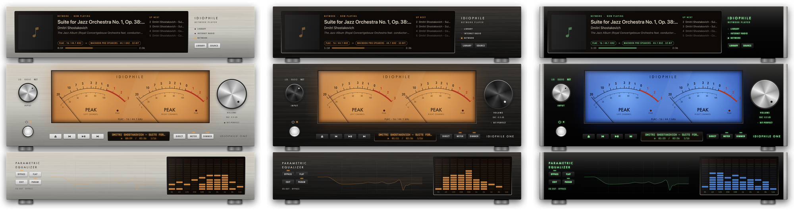
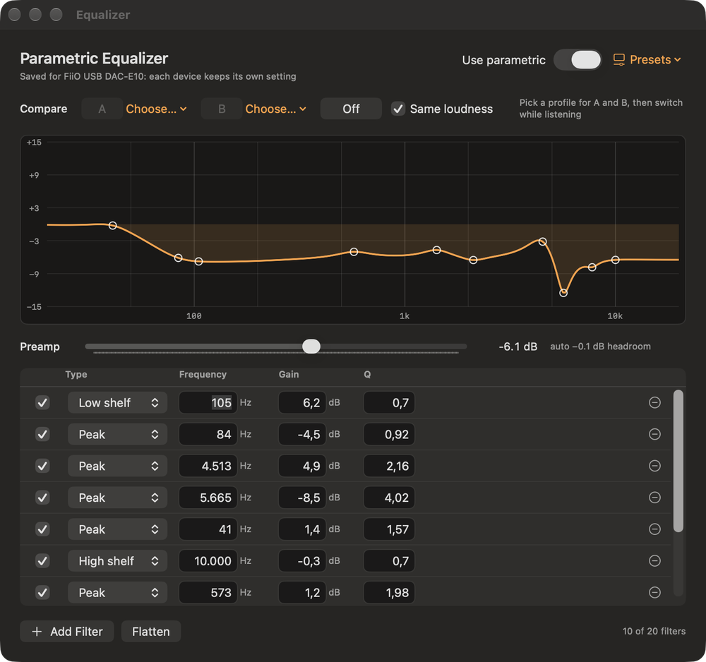
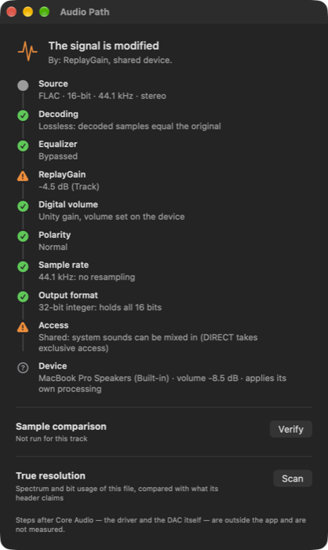
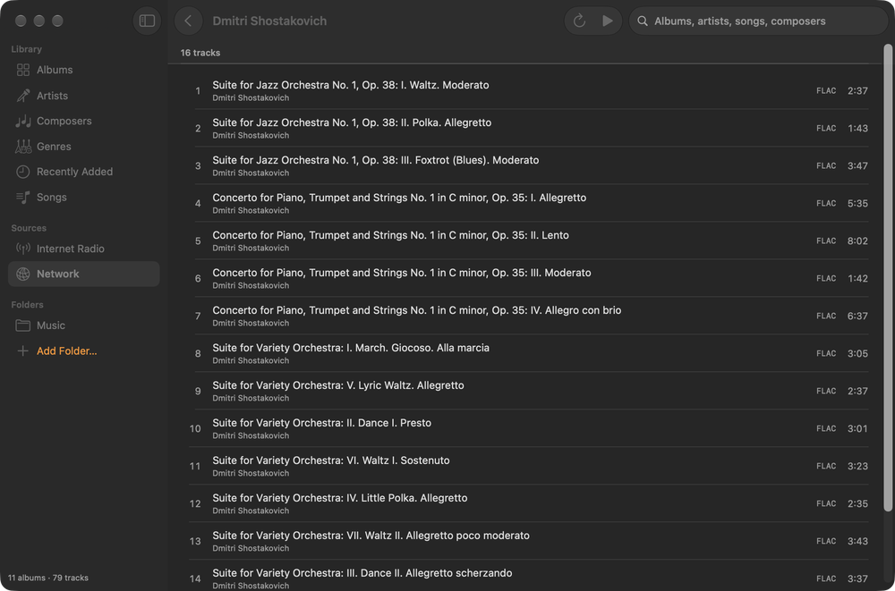
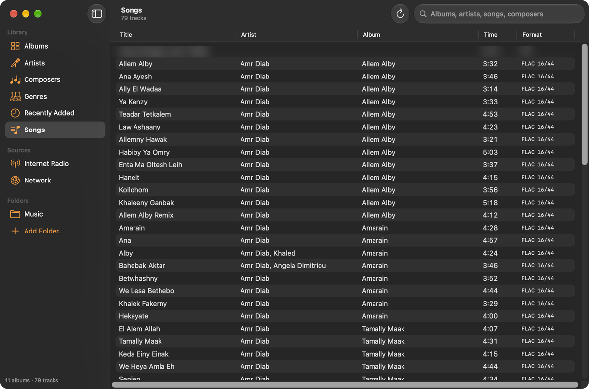
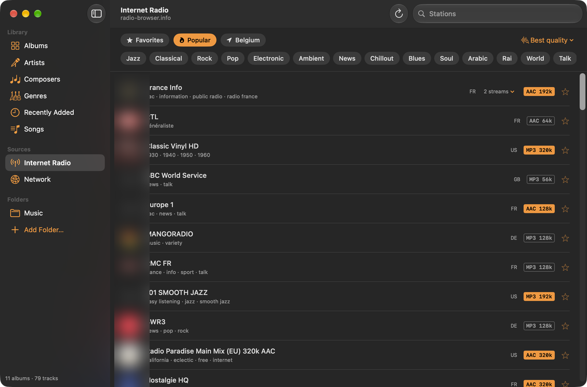
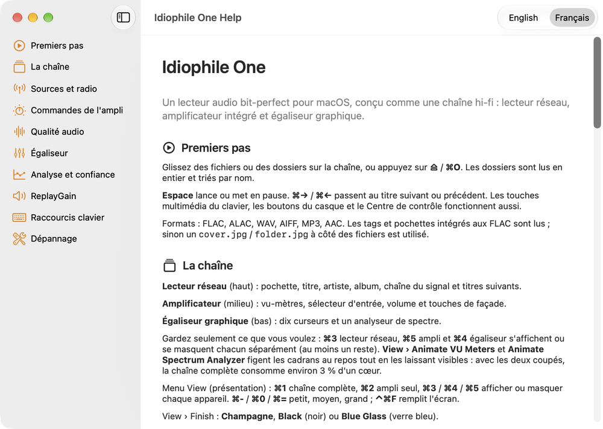

# Idiophile One

**Un lecteur audio gratuit, open source et bit-perfect pour macOS, conçu comme une chaîne hi-fi vintage.**

> [!WARNING]
> **Version alpha.** Idiophile One est une première alpha publique (0.1.0-alpha). Elle sert tous
> les jours sur le Mac de son auteur, mais n'a été testée que sur très peu de machines et de DAC.
> Attendez-vous à des bugs, des fonctions manquantes et des réglages qui peuvent changer d'une
> version à l'autre. Gardez un volume raisonnable sur votre DAC ou votre ampli la première fois,
> et [signalez ce qui ne va pas](https://github.com/dev-digitaldream/idiophile-one/issues).

*English version: [README.md](README.md)*

## Pourquoi

Sur Mac, les lecteurs audiophiles sont chers, sur abonnement, ou austères. Idiophile One veut
être la référence gratuite : un chemin du signal **vérifiable** (il vous dit, et peut prouver,
si les échantillons arrivent intacts à votre DAC), de vrais outils pour casques et enceintes,
et le plaisir d'une façade avec des aiguilles qui bougent.

## Téléchargement

1. Prenez le dernier **`Idiophile-One-<version>.dmg`** sur la
   [page Releases](https://github.com/dev-digitaldream/idiophile-one/releases).
2. Ouvrez-le et glissez **Idiophile One** dans **Applications**.
3. **Premier lancement.** L'alpha n'est ni signée avec un Developer ID Apple ni notarisée :
   macOS la bloque la première fois.
   - Ouvrez Idiophile One une fois, fermez l'alerte, puis allez dans **Réglages Système ›
     Confidentialité et sécurité**, descendez et cliquez **Ouvrir quand même** à côté de
     *« Idiophile One » a été bloqué*.
   - Ou dans le Terminal : `xattr -dr com.apple.quarantine "/Applications/Idiophile One.app"`

   Ne le faites qu'avec une copie téléchargée depuis la page Releases de ce dépôt. Chaque
   version donne le SHA-256 de ses fichiers pour les vérifier (`shasum -a 256 <fichier>`).

**Configuration :** macOS 14 Sonoma ou plus récent, Apple silicon ou Intel. Un DAC USB externe
est recommandé : les haut-parleurs intégrés du MacBook appliquent leur propre traitement et ne
peuvent jamais être bit-perfect.

## Ce qui marche aujourd'hui

| | |
|---|---|
| **Lecture** | FLAC, ALAC, WAV, AIFF, MP3, AAC · gapless quand le format le permet · touches multimédia et Centre de contrôle |
| **Bit-perfect** | Le DAC suit la fréquence de chaque fichier et son format entier le plus précis · le mode **DIRECT** prend l'accès exclusif · le voyant **BIT-PERFECT** ne s'allume que si toutes les conditions sont réunies · **Audio Path** liste chaque étape du fichier au DAC, et **Verify** compare un à un les échantillons envoyés à Core Audio avec le fichier |
| **Bibliothèque** | Albums, artistes, compositeurs, genres, morceaux · recherche instantanée · lire ensuite / ajouter à la file · pochettes FLAC ou `cover.jpg` |
| **Radio internet** | Annuaire radio-browser.info, favoris, recherche par pays et genre · les flux d'une même station sont regroupés et le meilleur est joué (codec et débit) |
| **Réseau** | Serveurs DLNA / UPnP (NAS) trouvés automatiquement ou ajoutés par adresse |
| **Égaliseur** | Graphique 10 bandes ou paramétrique jusqu'à 20 filtres (double précision, bypass exact, marge automatique) · un réglage par sortie · import AutoEq / Equalizer APO (fichier, glisser-déposer, presse-papiers) · profils casque intégrés · **comparaison A/B à volume égal** pendant l'écoute |
| **Analyse** | ReplayGain par tags ou mesuré (EBU R128) · résolution réelle (repère le faux hi-res et les sources compressées) · inversion de polarité |
| **L'objet** | Lecteur réseau, ampli intégré avec vu-mètres VU / PEAK et analyseur de spectre · trois finitions · mini-lecteur (≈ 2 % d'un cœur) · chaque appareil s'affiche ou se masque · menu clic droit complet · aide en français et en anglais |

## Limites connues (alpha)

- Le moteur audio est AVAudioEngine en flottant 32 bits : les sources au-delà de 24 bits sont
  arrondies à 24 bits, et l'app l'indique. Un moteur Core Audio dédié est prévu.
- Le gapless n'est exact à l'échantillon près que si le format, le ReplayGain et la polarité ne
  changent pas entre deux morceaux.
- Pas encore de DSD, de convolution / correction de pièce, ni de services de streaming.
- Les radios HLS et Ogg passent par le lecteur système : pas de vu-mètres ni d'égaliseur.
- Testé sur peu de DAC. Le volume a des règles de sécurité (un nouveau DAC démarre bas, les
  sauts brusques sont refusés), mais restez prudent au casque.

## Captures d'écran

| Égaliseur paramétrique, A/B | Audio Path | Réseau (DLNA) |
|---|---|---|
|  |  |  |

| Bibliothèque | Radio internet | Aide intégrée |
|---|---|---|
|  |  |  |

Le [guide d'utilisation](docs/USER-GUIDE.fr.md) montre chaque partie de l'app avec ses menus et ses raccourcis.

## Documentation

- [Guide d'utilisation](docs/USER-GUIDE.fr.md) · [User guide](docs/USER-GUIDE.md)
- [Compiler depuis les sources](docs/BUILDING.md) (en anglais)
- [Architecture](docs/ARCHITECTURE.md) (en anglais)
- [Contribuer](CONTRIBUTING.md) · [Sécurité](SECURITY.md) · [Crédits](CREDITS.md)

## Feuille de route

1. Moteur Core Audio dédié : chemin entier, sources 32 bits, gapless exact.
2. Version iPad pour DAC USB-C.
3. DSD (DoP), convolution / correction de pièce, crossfeed.
4. Listes intelligentes, édition des tags.
5. Courbe d'égaliseur interactive.

## Licence

[GPL-3.0 ou ultérieure](LICENSE).
