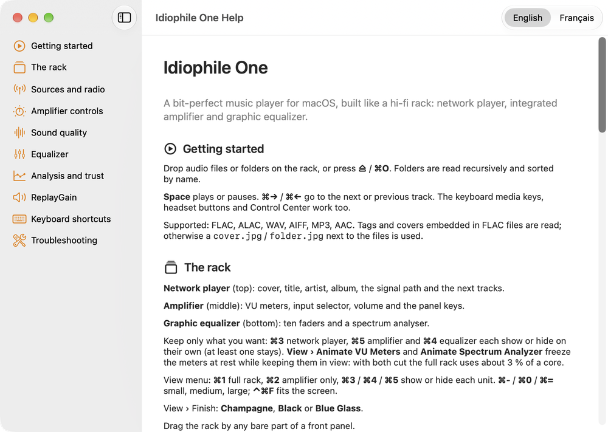
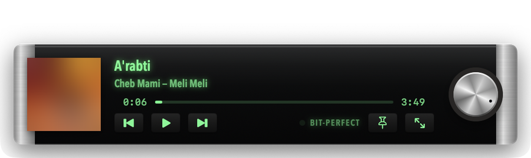

# Idiophile One

**A free, open-source, bit-perfect music player for macOS — built like a vintage hi-fi stack.**

> [!WARNING]
> **Alpha software.** Idiophile One is an early public alpha (0.1.0-alpha). It plays music every
> day on its author's Mac, but it has been tested on very few machines and DACs. Expect bugs,
> missing features and settings that may change between versions. Keep the volume of your DAC
> or amplifier reasonable the first time you play through it, and please
> [report what goes wrong](https://github.com/dev-digitaldream/idiophile-one/issues).

*Version française : [README.fr.md](README.fr.md)*

## Why

Audiophile players on the Mac are either expensive, subscription-based, or plain. Idiophile One
aims to be the free reference: a **verifiable** signal path (it tells you, and can prove, whether
the samples reach your DAC untouched), proper tools for headphone and speaker owners, and the
pleasure of a real front panel with moving needles.

## Download

1. Get the latest **`Idiophile-One-<version>.dmg`** from the
   [Releases page](https://github.com/dev-digitaldream/idiophile-one/releases).
2. Open it and drag **Idiophile One** to **Applications**.
3. **First launch.** The alpha is not signed with an Apple Developer ID nor notarised, so macOS
   blocks it the first time:
   - Open Idiophile One once, dismiss the warning, then go to **System Settings › Privacy &
     Security**, scroll down and click **Open Anyway** next to *"Idiophile One" was blocked*.
   - Or, in Terminal: `xattr -dr com.apple.quarantine "/Applications/Idiophile One.app"`

   Only do this with a copy downloaded from this repository's Releases page. Each release lists
   the SHA-256 of its files so you can check them (`shasum -a 256 <file>`).

**Requirements:** macOS 14 Sonoma or later, Apple silicon or Intel. An external USB DAC is
recommended: the MacBook's built-in speakers apply their own processing, so they can never be
bit-perfect.

## What works today

| | |
|---|---|
| **Playback** | FLAC, ALAC, WAV, AIFF, MP3, AAC · gapless when the format allows it · media keys and Control Center |
| **Bit-perfect** | The DAC follows each file's sample rate and uses its deepest integer format · **DIRECT** mode takes exclusive access · the **BIT-PERFECT** lamp lights only when every condition holds · **Audio Path** lists each step from file to DAC, and **Verify** compares the samples sent to Core Audio with the file, one by one |
| **Library** | Albums, artists, composers, genres, songs · instant search · play next / add to queue · covers from FLAC or `cover.jpg` |
| **Internet radio** | radio-browser.info directory, favourites, search by country and genre · several streams of one station are grouped and the best one is played (codec- and bitrate-aware) |
| **Network** | DLNA / UPnP media servers (NAS) found automatically, or added by address |
| **Equalizer** | 10-band graphic or parametric up to 20 filters (double precision, exact bypass, automatic headroom) · one setting per output device · AutoEq / Equalizer APO import (file, drag-and-drop, clipboard) · built-in headphone profiles · **A/B compare at equal loudness** while the music plays |
| **Analysis** | ReplayGain from tags or measured (EBU R128) · true-resolution scan (spots fake hi-res and lossy sources) · polarity inversion |
| **The object** | Network player, integrated amplifier with VU / PEAK meters and a spectrum analyser · three finishes · compact player (≈ 2 % of a CPU core) · show or hide each unit · full right-click menu · help in English and French |

## Known limits (alpha)

- The audio engine is AVAudioEngine in 32-bit float: sources above 24 bits are rounded to 24
  bits, and the app says so. A dedicated Core Audio engine is planned.
- Gapless is sample-accurate only when format, ReplayGain and polarity do not change between
  two tracks.
- No DSD, no convolution / room correction, no streaming services yet.
- HLS and Ogg radio streams play through the system player: no meters or equalizer for those.
- Tested on a small number of DACs. Volume handling has safety rules (a new DAC starts quiet,
  sudden jumps are refused), but please be careful with headphones.

Full status: [CHANGELOG.md](CHANGELOG.md) · roadmap below.

## Screenshots

| Parametric EQ with A/B compare | Audio Path | Network (DLNA) |
|---|---|---|
|  |  |  |

| Library | Internet radio | Built-in help (EN / FR) |
|---|---|---|
|  |  |  |

The [user guide](docs/USER-GUIDE.md) shows every part of the app with its menus and shortcuts.

## Documentation

- [User guide](docs/USER-GUIDE.md) · [Guide d'utilisation](docs/USER-GUIDE.fr.md) (the same text as Help › Idiophile One Help)
- [Building from source](docs/BUILDING.md)
- [Architecture](docs/ARCHITECTURE.md)
- [Contributing](CONTRIBUTING.md) · [Security](SECURITY.md) · [Credits](CREDITS.md)

## Roadmap

1. Dedicated Core Audio engine: integer path, 32-bit sources, sample-accurate gapless.
2. iPad version for USB-C DACs.
3. DSD (DoP), convolution / room correction, crossfeed.
4. Smart playlists, tag editing.
5. Interactive EQ curve (drag the filters).

## Licence

[GPL-3.0-or-later](LICENSE). Idiophile One is free software: you can redistribute it and/or
modify it under the terms of the GNU General Public License, version 3 or later.
