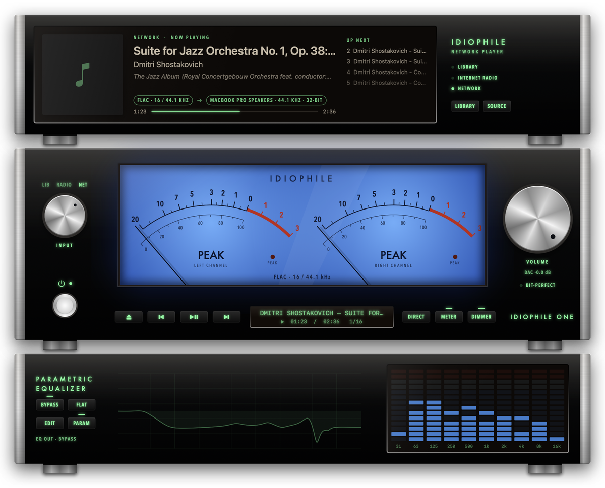
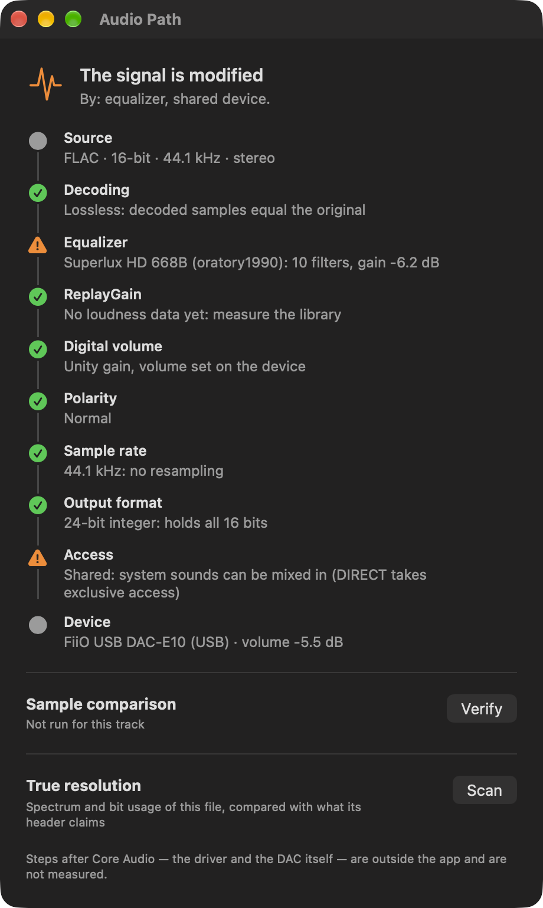

# Idiophile One — Guide d'utilisation

> Généré depuis l'aide intégrée (Help › Idiophile One Help) par `scripts/gen-guide.py`. English version: [USER-GUIDE.md](USER-GUIDE.md).

Un lecteur audio bit-perfect pour macOS, conçu comme une chaîne hi-fi : lecteur réseau, amplificateur intégré et égaliseur graphique.

- [Premiers pas](#premiers-pas)
- [La chaîne](#la-chane)
- [Sources et radio](#sources-et-radio)
- [Commandes de l'ampli](#commandes-de-lampli)
- [Qualité audio](#qualit-audio)
- [Égaliseur](#galiseur)
- [Analyse et confiance](#analyse-et-confiance)
- [ReplayGain](#replaygain)
- [Raccourcis clavier](#raccourcis-clavier)
- [Dépannage](#dpannage)
- [Menus](#menus)

## Premiers pas

- Glissez des fichiers ou des dossiers sur la chaîne, ou appuyez sur **⏏** / **⌘O**. Les dossiers sont lus en entier et triés par nom.
- **Espace** lance ou met en pause. **⌘→** / **⌘←** passent au titre suivant ou précédent. Les touches multimédia du clavier, les boutons du casque et le Centre de contrôle fonctionnent aussi.
- Formats : FLAC, ALAC, WAV, AIFF, MP3, AAC. Les tags et pochettes intégrés aux FLAC sont lus ; sinon un `cover.jpg` / `folder.jpg` à côté des fichiers est utilisé.

*La bibliothèque : vue Morceaux.*

## La chaîne

- **Lecteur réseau** (haut) : pochette, titre, artiste, album, chaîne du signal et titres suivants.
- **Amplificateur** (milieu) : vu-mètres, sélecteur d'entrée, volume et touches de façade.
- **Égaliseur graphique** (bas) : dix curseurs et un analyseur de spectre.
- Gardez seulement ce que vous voulez : **⌘3** lecteur réseau, **⌘5** ampli et **⌘4** égaliseur s'affichent ou se masquent chacun séparément (au moins un reste). **View › Animate VU Meters** et **Animate Spectrum Analyzer** figent les cadrans au repos tout en les laissant visibles : avec les deux coupés, la chaîne complète consomme environ 3 % d'un cœur.
- Menu View (présentation) : **⌘1** chaîne complète, **⌘2** ampli seul, **⌘3** / **⌘4** / **⌘5** afficher ou masquer chaque appareil. **⌘-** / **⌘0** / **⌘=** petit, moyen, grand ; **⌃⌘F** remplit l'écran.
- View › Finish : **Champagne**, **Black** (noir) ou **Blue Glass** (verre bleu).
- Déplacez la chaîne en la saisissant par une zone libre d'une façade.
- Un **clic droit** n'importe où sur la chaîne ou sur le mini-lecteur ouvre le menu complet : lecture, source, sortie, son, apparence et analyse.
- Le **mini-lecteur** (⌥⌘M) est un lecteur fin pour quand vous travaillez. Rien n'y est animé : environ 2 % d'un cœur de processeur.

*La chaîne complète, finition Blue Glass.*

*Les trois finitions : Champagne, Black, Blue Glass.*

*Le mini-lecteur.*

## Sources et radio

- Le bouton **INPUT** et **Playback › Source** (⌃1 / ⌃2 / ⌃3) changent vraiment de source. **LIB** revient à votre file de bibliothèque là où elle s'était arrêtée, **RADIO** joue la dernière station, **NET** ouvre vos serveurs. Une source sans rien à jouer ouvre son navigateur.
- **Radio internet** (fenêtre Bibliothèque › Internet Radio) : favoris, stations populaires, votre pays, genres et recherche. Marquez une station d'une étoile pour la garder ; glissez les favoris pour les ordonner.
- Une station propose souvent plusieurs flux. Idiophile One les regroupe et joue **le meilleur** : il pèse le codec et le débit (AAC 128 vaut mieux que MP3 128), évite les flux morts ou HLS quand il peut, et préfère le https. Choisissez *Best*, *Balanced* (jusqu'à 128 kb/s) ou *Light* (jusqu'à 64 kb/s), ou désactivez le choix automatique. Le menu **N streams** d'une ligne permet de choisir à la main.
- La radio passe par le même moteur que les fichiers : vu-mètres, égaliseur et horloge du DAC s'appliquent. Elle n'est jamais bit-perfect.
- **Réseau** (fenêtre Bibliothèque › Network) : les serveurs DLNA / UPnP de votre réseau sont trouvés automatiquement. Un serveur hors de portée de la découverte (VPN, autre sous-réseau) s'ajoute par nom ou adresse. Certains NAS ne servent que les appareils autorisés : sur un QNAP, autorisez ce Mac dans DLNA Media Server › Media Receivers.

*Radio internet : flux regroupés par station, meilleure qualité choisie pour vous.*

*Un serveur DLNA / UPnP parcouru depuis la source Network.*

## Commandes de l'ampli

- **POWER** éteint les lampes en fondu et quitte. Le volume est mémorisé.
- **VOLUME** : tournez-le en glissant autour du bouton, à la molette (vers le haut = plus fort) ou avec les touches de volume du clavier. Si le DAC a son propre volume, le bouton le pilote directement : les échantillons restent intacts.
- **DIRECT** prend le chemin le plus court : égaliseur et ReplayGain retirés, accès exclusif au DAC (les autres apps et sons système y sont coupés).
- **METER** passe de **VU** (balistique classique de 300 ms) à **PEAK** (attaque rapide, retombée lente).
- **DIMMER** règle le rétroéclairage : plein, chaud ou tamisé.
- Le voyant **BIT-PERFECT** s'allume quand le fichier arrive au DAC sans aucune modification.

## Qualité audio

- Choisissez votre DAC dans le menu **Output**. Un DAC branché plus tard apparaît tout seul.
- L'horloge du DAC suit la fréquence de chaque fichier : rien n'est rééchantillonné. Si le DAC ne gère pas cette fréquence, le lecteur affiche **RESAMPLED**.
- Le DAC est réglé sur son format entier le plus précis (par exemple 24 bits) : aucun bit n'est perdu.
- BIT-PERFECT exige : DIRECT activé, même fréquence et assez de bits sur le DAC, et le volume sur le DAC (ou le bouton au maximum).
- Les haut-parleurs du MacBook appliquent leur propre traitement : utilisez un DAC externe pour un vrai chemin bit-perfect.

*Audio Path : chaque étape du fichier au DAC, lue en direct.*

## Égaliseur

- Chaque sortie garde son propre réglage d'égaliseur : un casque et des enceintes demandent des courbes différentes. Une nouvelle sortie démarre à plat.
- **EDIT** (ou Output › Equalizer Editor, ⌥⌘E) ouvre l'**éditeur paramétrique** : jusqu'à 20 filtres (cloche, shelf grave ou aigu, passe-haut ou passe-bas, notch) avec fréquence, gain et Q, un préampli et la courbe de réponse. **PARAM** bascule entre les curseurs et votre profil paramétrique ; quand le profil est utilisé, le rack affiche sa courbe à la place des curseurs.
- **Correction de casque** : Presets › Headphones (built-in) propose des profils prêts à l'emploi. Pour ajouter les vôtres, déposez un ou plusieurs fichiers `.txt` AutoEq / Equalizer APO sur l'éditeur, passez par Presets › Import, ou copiez la liste de filtres puis **Paste Filters from Clipboard** (`Preamp: -6.2 dB`, `Filter 1: ON PK Fc 100 Hz Gain -3 dB Q 0.7`). Les fichiers importés deviennent des presets. Vos réglages peuvent être enregistrés et exportés dans le même format.
- **Comparer (A/B)** : dans l'éditeur, chargez un profil en **A** et un autre en **B**, puis basculez avec **A**, **B**, **Off** (touches 1, 2, 3) pendant l'écoute. **Same loudness** baisse le choix le plus fort au niveau du plus faible : vous jugez la courbe, pas le volume. Les bascules sont progressives : aucun clic.
- Une accentuation ne sature jamais : le point le plus fort de la courbe est tenu à 0 dB par une marge automatique (le préampli d'un profil AutoEq la fournit déjà). Un égaliseur à plat ne change rien, au bit près.
- Glissez un curseur ou utilisez la molette dessus ; un double-clic le remet à 0 dB.
- **BYPASS** retire l'égaliseur ; **FLAT** remet toutes les bandes à zéro. Une atténuation d'entrée s'applique automatiquement quand vous montez une bande, pour éviter la saturation.
- En DIRECT, l'égaliseur est retiré (**EQ OUT · DIRECT**). Toucher un curseur ou BYPASS fait sortir de DIRECT.

*L'éditeur paramétrique avec la barre Compare (A/B).*

## Analyse et confiance

- Le **chemin audio** (Output › Audio Path, ⌥⌘A) liste chaque étape du fichier au DAC, lue en direct : transparente, modifie le signal, ou impossible à vérifier. **Verify** compare un à un les échantillons envoyés à Core Audio avec le fichier.
- La **résolution réelle** (Scan dans le même panneau) lit le spectre et les bits réellement utilisés : elle révèle un fichier 96 kHz qui est en fait un master 44,1 kHz, un filtre typique du MP3/AAC, ou un contenu 16 bits dans un fichier 24 bits.
- Le **volume sonore** est mesuré en arrière-plan (EBU R128) pour chaque titre sans tags ReplayGain, enregistré dans la bibliothèque, jamais dans vos fichiers.
- La **polarité** (Output) : inversez un titre ou tous. Chaque échantillon est exactement nié ; le chemin apparaît alors comme modifié.
- Le **délai après changement de fréquence** laisse au DAC le temps de se stabiliser pour ne pas perdre le début d'un titre.
- **Lock Output** garde la lecture hors des haut-parleurs si votre DAC disparaît ; elle attend et se reconnecte en pause. Chaque DAC retient son volume et sa limite, et un nouveau démarre doucement.

*Audio Path avec l'égaliseur et le volume du DAC en jeu.*

## ReplayGain

- Output › ReplayGain égalise le volume : **Track** aligne chaque morceau, **Album** préserve les nuances d'un album.
- Il faut des tags ReplayGain dans les fichiers ; les crêtes ne dépassent jamais le maximum. Désactivé en DIRECT.

## Raccourcis clavier

- **Espace** lecture/pause · **⌘→** suivant · **⌘←** précédent · **⌘O** ouvrir · **⇧⌘M** couper le son
- **⌥⌘M** mini-lecteur · **⌥⌘E** éditeur d'égaliseur · **⌥⌘A** chemin audio
- **⇧⌘B** DIRECT · **⇧⌘D** variateur · **⇧⌘P** éteindre
- **⌘1–⌘4** composition de la chaîne · **⌘- ⌘0 ⌘=** taille · **⌃⌘F** plein écran · **⌘?** aide

## Dépannage

- **Pas de son** : vérifiez Output, la position du bouton et le volume propre du DAC. Les autres apps sont muettes sur le DAC tant que DIRECT est actif.
- **BIT-PERFECT reste éteint** : activez DIRECT et regardez la chaîne du signal sur le lecteur (RESAMPLED ou moins de bits).
- **Vu-mètres lents** : appuyez sur METER pour le mode PEAK ; le mode VU est lent par conception.

*L'aide intégrée (Help › Idiophile One Help), en anglais et en français.*

## Menus

- **File** : Open… (⌘O) · Library (⌘L) · Close (⌘W) · Close All (⌥⌘W)
- **View** : Full Rack (⌘1) · Amplifier Only (⌘2) · Compact Player (⌥⌘M) · Network Player (⌘3) · Equalizer (⌘4) · Amplifier (⌘5) · Animate VU Meters · Animate Spectrum Analyzer · Small (⌘-) / Medium (⌘0) / Large (⌘=) · Fit Screen (⌃⌘F) · Finish ▸ Champagne, Black, Blue Glass
- **Output** : Output Device ▸ (System Default et chaque appareil trouvé) · Lock Output · Rate Change Delay ▸ · Volume Limit ▸ · Invert Polarity of This Track (⌥⌘I) / of All Tracks · Measure Library Loudness · ReplayGain ▸ Off, Track, Album · Equalizer Editor… (⌥⌘E) · Audio Path… (⌥⌘A) · Scan True Resolution… · Verify Bit-Perfect Path… (⌥⌘V) · Direct (⇧⌘B)
- **Playback** : Source ▸ Library (⌃1), Internet Radio (⌃2), Network (⌃3) · Play / Pause (Espace) · Next Track (⌘→) · Previous Track (⌘←) · Mute (⇧⌘M) · Power Off (⇧⌘P) · Dimmer (⇧⌘D)
- **Window** : Compact Player · Library · Equalizer · Audio Path
- **Help** : Idiophile One Help (⌘?)
- **Clic droit** sur la chaîne ou le mini-lecteur : les mêmes commandes de lecture, source, sortie, son, apparence et analyse dans un seul menu.
